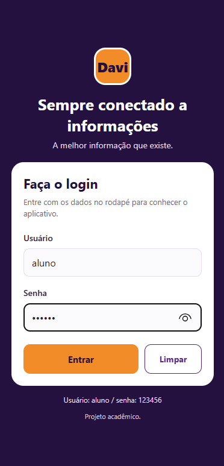
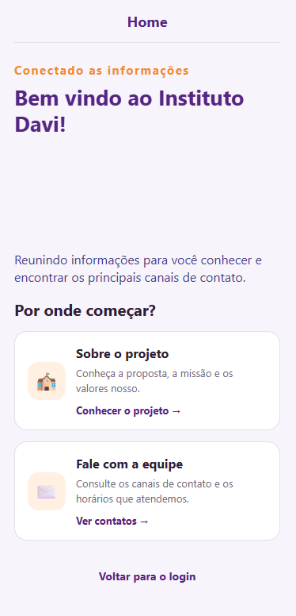
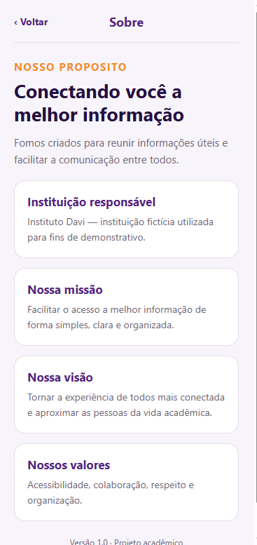

# App Instituto Davi

Aplicativo mobile institucional desenvolvido como atividade acadêmica para praticar criação de telas, validação de login, navegação entre páginas, uso de Toolbar, componentização e estilização com `StyleSheet`.

## Identificação

- **Aluno:** `Davi Silva Santo Farias`
- **Aplicativo:** Instituto Davi
- **Finalidade:** atividade acadêmica de navegação e Toolbar para dispositivos móveis.

## Funcionalidades

- Tela de Login com campos de usuário e senha.
- Ocultação dos caracteres da senha.
- Validação de campos vazios e de credenciais inválidas.
- Botões **Entrar** e **Limpar**.
- Navegação entre as telas **Home**, **Sobre** e **Contato**.
- Toolbar reutilizável com título da tela e botão para voltar quando necessário.
- Informações institucionais, missão, visão, valores e canais de contato.
- Identidade visual com tons de roxo e laranja.

## Tecnologia utilizada

- React Native
- Expo
- JavaScript
- `StyleSheet` do React Native

## Credenciais para testar

O login é apenas uma simulação acadêmica. Use:

- **Usuário:** `aluno`
- **Senha:** `123456`

Não há autenticação real, API, servidor, banco de dados ou armazenamento persistente das credenciais. Ao reiniciar a aplicação, ela deve começar novamente na tela Login.

## Como executar

### Pelo Expo Snack

1. Abra o projeto no Expo Snack.
2. Confira os arquivos do projeto e execute a prévia.
3. Use o QR code do Snack para abrir no dispositivo compatível, quando disponível.

### Pelo computador

Tenha Node.js instalado. Na pasta do projeto, execute:

```bash
npm install
npx expo start
```

Depois, siga as instruções exibidas no terminal para abrir no emulador ou dispositivo.

## Estrutura do projeto

```text
Conecta-Campus/
├── App.js
├── index.js
├── app.json
├── package.json
├── README.md
├── assets/
│   ├── icon.png
│   ├── adaptive-icon.png
│   ├── splash-icon.png
│   └── favicon.png
└── src/
    ├── components/
    │   ├── CartaoNavegacao.js
    │   └── Toolbar.js
    ├── screens/
    │   ├── Login.js
    │   ├── Home.js
    │   ├── Sobre.js
    │   └── Contato.js
    └── styles.js
```

### 1. Login



### 2. Home



### 3. Sobre



### 4. Contato


## Observação

Projeto desenvolvido para fins educacionais. As credenciais são fixas no código e servem somente para demonstrar a validação de entrada e a navegação entre telas.
